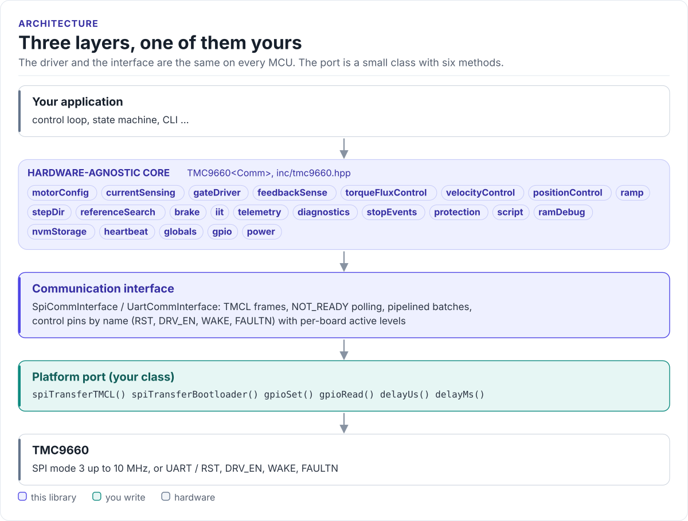

# TMC9660 Driver

A C++20 driver for the Analog Devices (Trinamic) TMC9660 smart motor controller: boot, configure and run BLDC,
stepper and DC motors with on-chip field-oriented control, from any MCU with SPI or UART.

[](https://github.com/hardfoc/hf-tmc9660-driver/actions/workflows/ci-host-tests.yml)
[](https://github.com/hardfoc/hf-tmc9660-driver/actions/workflows/esp32-examples-build-ci.yml)
[](https://hardfoc.github.io/hf-tmc9660-driver/)
[](LICENSE)

**Documentation: <https://hardfoc.github.io/hf-tmc9660-driver/>**

<!-- figure: driver-layers -->
<picture>
  <source media="(prefers-color-scheme: dark)" srcset="docs/diagrams/driver-layers.dark.svg">
  
</picture>
<!-- /figure -->

## In 30 seconds

Write a small port class for your MCU (SPI transfer, four GPIOs, a delay;
[Porting](https://hardfoc.github.io/hf-tmc9660-driver/latest/porting/)), then:

<!-- generated: quickstart-code -->
```cpp
#include "tmc9660.hpp"

int spin_bldc_at_1000_rpm(MySpi& spi) {
  tmc9660::TMC9660<MySpi> driver(spi);

  tmc9660::BootloaderConfig cfg{};                          // 1. boot into parameter mode
  cfg.boot.boot_mode = tmc9660::bootcfg::BootMode::Parameter;
  cfg.boot.start_motor_control = true;
  if (driver.bootloaderInit(&cfg) != tmc9660::TMC9660<MySpi>::BootloaderInitResult::Success) {
    return -1;                                              // wiring, power or SPI mode
  }

  driver.motorConfig.setType(tmc9660::tmcl::MotorType::BLDC_MOTOR, 7);  // 2. motor: 7 pole pairs
  driver.motorConfig.setPWMFrequency(25000);

  const auto ctx = driver.getMotorContext();                // 3. unit conversions from the chip
  driver.velocityControl.setTargetVelocityRpm(1000.0, ctx); // 4. spin
  return 0;
}
```
<!-- /generated -->

## What it does

- Boots the chip into parameter mode (`bootloaderInit()`), including clock, interface and encoder settings.
- Exposes the chip as subsystems: `motorConfig`, `feedbackSense`, `torqueFluxControl`, `velocityControl`,
  `positionControl`, `ramp`, `telemetry`, `protection`, `diagnostics` and more.
- Converts RPM, degrees and amperes to the chip's internal units with the motor's real settings.
- Talks SPI the way the datasheet specifies: NOT_READY polling, no fixed delays, pipelined batches (N reads in
  N + 1 datagrams).
- No heap, no exceptions, no RTOS, no virtual calls (the port is a CRTP class).

## Install

```bash
git submodule add https://github.com/hardfoc/hf-tmc9660-driver.git external/hf-tmc9660-driver
```

```cmake
add_subdirectory(external/hf-tmc9660-driver)
target_link_libraries(my_app PRIVATE hf_tmc9660)
```

ESP-IDF: use the component wrapper in [`examples/esp32/components/hf_tmc9660`](examples/esp32/components/hf_tmc9660/CMakeLists.txt).
Details: [Installation](https://hardfoc.github.io/hf-tmc9660-driver/latest/installation/).

## Documentation

| | |
| --- | --- |
| [Quickstart](https://hardfoc.github.io/hf-tmc9660-driver/latest/quickstart/) | Wire it, write the port, spin a motor |
| [Hardware](https://hardfoc.github.io/hf-tmc9660-driver/latest/hardware/) | Pins, bus settings, errata, evaluation kits |
| [API guide](https://hardfoc.github.io/hf-tmc9660-driver/latest/api-guide/) | Configure, command, read, handle errors |
| [Timing and throughput](https://hardfoc.github.io/hf-tmc9660-driver/latest/timing/) | What one access costs and how to tune it |
| [Examples](https://hardfoc.github.io/hf-tmc9660-driver/latest/examples/) | ESP32 test applications |
| [API reference](https://hardfoc.github.io/hf-tmc9660-driver/latest/api/) | Doxygen, every class and member |

The pages are in [`docs/`](docs/index.md); the datasheets are in [`docs/datasheet/`](docs/datasheet/).

## Tests

```bash
cmake -S . -B build-host -DHF_TMC9660_BUILD_TESTS=ON && cmake --build build-host && ctest --test-dir build-host
```

The host tests run the driver against a model of the chip; the code on the documentation site is compiled by the
same build.

## License

GPL-3.0. See [LICENSE](LICENSE).
