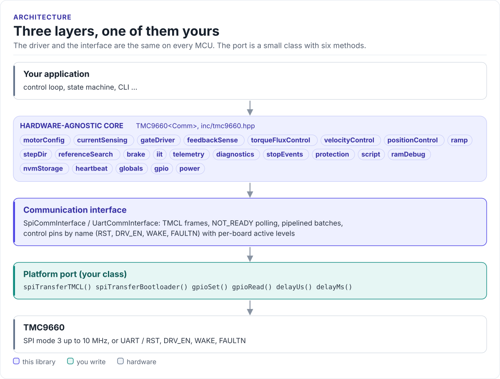
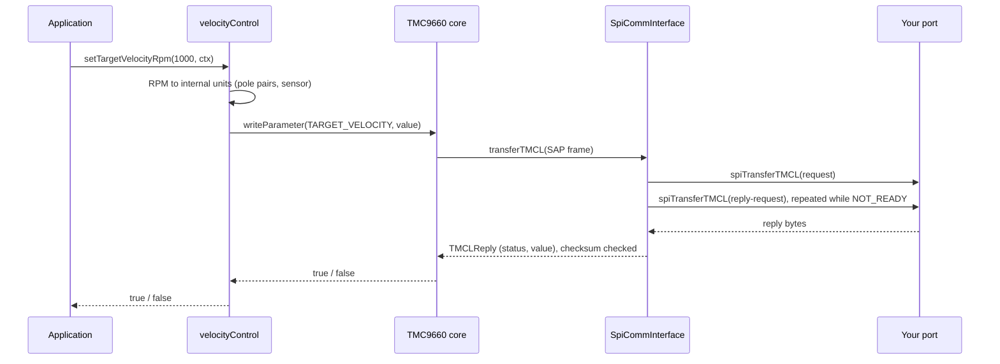

# Architecture

How the driver is put together: three layers, what each owns, and how one call reaches the chip.

<!-- figure: driver-layers -->
<picture>
  <source media="(prefers-color-scheme: dark)" srcset="diagrams/driver-layers.dark.svg">
  
</picture>
<!-- /figure -->

## The three layers

| Layer | Where | Depends on | You change it when |
| --- | --- | --- | --- |
| **Hardware-agnostic core**: `TMC9660<Comm>` and its subsystems | [`inc/tmc9660.hpp`](../inc/tmc9660.hpp), [`src/tmc9660.ipp`](../src/tmc9660.ipp) | The interface's methods only | Never, for a new board |
| **Communication interface**: `SpiCommInterface`, `UartCommInterface` | [`inc/tmc9660_comm_interface.hpp`](../inc/tmc9660_comm_interface.hpp) | Six methods of your port | Never |
| **Platform port**: your class | Your project | Your SDK | Once per MCU or board ([Porting](porting.md)) |

Everything above the port is the same on ESP32, STM32, a Linux host or the unit-test mocks. That is how the
[host tests](testing.md) run the real driver code without hardware.

## How one call reaches the chip

## Why CRTP

The interface is a class template parameter, not a virtual base class. The compiler sees your port's methods
directly and inlines them; the driver has no vtable, allocates nothing and needs no RTTI. The cost is that the
driver type names the port: `TMC9660<MySpi>`. Code that has to work with several port types takes the driver as
a template parameter too.

## Parameter mode and register mode

The TMC9660 runs in one of two modes, chosen by the bootloader:

- **Parameter mode** (what this driver drives): the chip's firmware runs FOC and exposes TMCL parameters such as
  `TARGET_VELOCITY` and `MAX_TORQUE`. The host sends a few hundred bytes a second.
- **Register mode**: the host runs the control loop and writes the motion-control registers itself. The register
  maps are in [`inc/register_mode/`](../inc/register_mode/tmc9660_mcc.hpp) for reference; the driver's API does
  not use them.

## Source map

| Path | Contents |
| --- | --- |
| `inc/tmc9660.hpp` | `TMC9660<Comm>`: subsystems, parameter access, batches, bootloader entry |
| `src/tmc9660.ipp` | Template implementation, included by the header |
| `inc/tmc9660_comm_interface.hpp` | Interfaces, TMCL frames, SPI timing and statistics, control pins |
| `inc/parameter_mode/tmc9660_param_mode_tmcl.hpp` | Every TMCL parameter, command and enum |
| `inc/bootloader/` | Bootloader protocol and `BootloaderConfig` |
| `inc/tmc9660_units.hpp`, `inc/tmc9660_diagnostics.hpp` | Unit conversion and diagnostic snapshots |
| `inc/register_mode/` | Register-mode maps (reference) |
| `tests/` | Host unit tests and the compiled documentation snippets |
| `examples/esp32/` | ESP-IDF applications |
