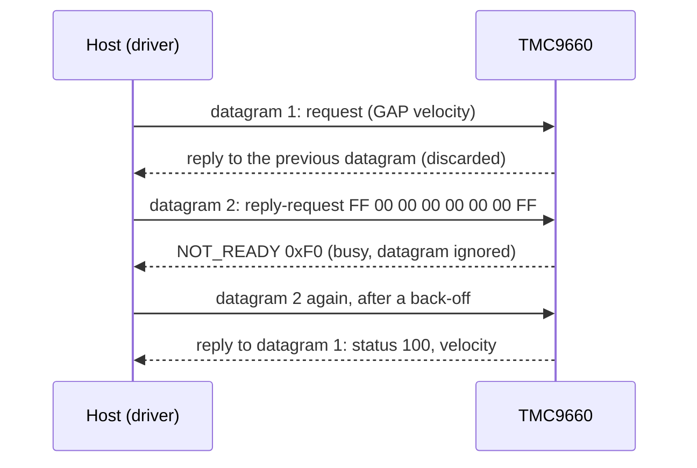

# Hardware

What to connect between your MCU and a TMC9660, with which bus settings, and the board-level traps to avoid.

All values here come from the [TMC9660 datasheet](datasheet/tmc9660.pdf) (Rev. 0) and the
[parameter-mode reference manual](datasheet/tmc9660-parameter-mode-reference-manual.pdf). When they disagree with a
board's schematic, the schematic wins for pin numbers and active levels.

{ .hf-plate }

## Host interface pins

The bootloader listens on both interfaces after power-up and answers on the one that sends it a valid command.

| Signal | TMC9660 pin | Direction | Notes |
| --- | --- | --- | --- |
| SPI0_MISO | 1 (GPIO9) | out | Does not go high-Z when CS is released (see the erratum below) |
| SPI0_MOSI | 2 (GPIO10) | in | |
| SPI0_SCK | 3 (GPIO11) | in | |
| SPI0_CS0 | 4 (GPIO12) | in | Active low; hold it low for the whole datagram |
| UART_TX | 62 (GPIO6) | out | Alternative to SPI |
| UART_RX | 63 (GPIO7) | in | Alternative to SPI |

The bootloader can move these functions to other pins and store the choice in OTP; see
[Configuration and bootstrapping](datasheet/tmc9660-configuration-and-bootstrapping.pdf).

## Control pins

The driver addresses these pins by name (`tmc9660::TMC9660CtrlPin`) and by state (`GpioSignal::ACTIVE` /
`INACTIVE`). Your port maps a state to a GPIO level with the active levels you pass to its constructor, so the
same driver code works with inverted or level-shifted signals.

| Pin | Direction (chip) | What it does | Driver use |
| --- | --- | --- | --- |
| RST | in | Holds the chip in reset while active | Pulsed by `bootloaderInit()` to enter the bootloader |
| DRV_EN | in | Enables the gate-driver outputs | Set active before commanding motion |
| WAKE | in | Wakes the chip from hibernation | Kept active during operation |
| FAULTN | out, open drain | Busy during bootstrapping, or a severe fault | Read by `bootloaderInit()` and by your fault handling |

FAULTN needs a pull-up to the MCU's I/O voltage. RST and DRV_EN have internal pull-downs.

## Bus settings

| Setting | SPI | UART |
| --- | --- | --- |
| Mode / format | Mode 3 (CPOL = 1, CPHA = 1), MSB first | 8 data bits, no parity, 1 stop bit |
| Speed | Up to 10 MHz (fSCK); start at 1 MHz for bring-up | Fixed rates or auto-baud (bootloader setting) |
| Frame | 8 bytes (64 bits) in parameter mode, 5 bytes in the bootloader | 9 bytes in parameter mode, 8 in the bootloader |
| Chip select | Low for the whole frame; high time tCSH at least 4 core clocks (about 100 ns) | n/a |
| Reply | Clocked out during the **next** datagram | Follows each request |

The SPI reply arrives one datagram late, and a busy chip answers `NOT_READY` (0xF0) and ignores that datagram.
The driver handles both; [Timing and throughput](timing.md) explains how and what it costs.

## Power

| Supply | Range | Notes |
| --- | --- | --- |
| VS (motor and gate driver) | 7.7 V to 70 V | Size the bulk capacitance for your motor current |
| VSA (core and buck) | 7.7 V to 80 V | Often tied to VS |
| VCC_IO (logic I/O) | 2.5 V to 5 V | Match your MCU's I/O voltage; sets the GPIO and DRV_EN levels |

Connect the MCU ground to the TMC9660 ground. Power the MCU before the motor supply so the control pins are
driven when the chip comes up.

## Errata that affect the host

!!! danger "SPI MISO stays driven after CS goes high (datasheet erratum 2)"
    The TMC9660 does not release MISO when its chip select is de-asserted. On a bus shared with other SPI devices
    it corrupts their replies. Either give the TMC9660 its own SPI bus, hold it in reset while you talk to the
    other devices, or add a switch on MISO gated by CS (the datasheet shows an ADG719).

## Evaluation kits

The [ESP32 examples](examples.md) run on an ESP32-C6 DevKit with either kit:

| Kit | Motor | Feedback | Document |
| --- | --- | --- | --- |
| TMC9660-3PH-EVKIT | 3-phase BLDC | Hall, ABN encoder | [User guide](datasheet/tmc9660-3ph-eval-kit-ug.pdf) |
| TMC9660-STP-EVKIT | 2-phase stepper | ABN encoder, reference switches | (Analog Devices website) |

The ESP32 pin assignment used by the examples lives in
[`esp32_tmc9660_test_config.hpp`](../examples/esp32/main/esp32_tmc9660_test_config.hpp).

## Reference documents

| Document | What it is for |
| --- | --- |
| [TMC9660 datasheet](datasheet/tmc9660.pdf) | Pins, electrical limits, errata |
| [Parameter-mode reference](datasheet/tmc9660-parameter-mode-reference-manual.pdf) | TMCL commands and every parameter the driver uses |
| [Register-mode reference](datasheet/tmc9660-register-mode-reference-manual.pdf) | Registers behind `inc/register_mode/` |
| [Configuration and bootstrapping](datasheet/tmc9660-configuration-and-bootstrapping.pdf) | Bootloader commands, OTP, pin remapping |
| [TMCL reference (2015)](datasheet/TMCL_reference_2015.pdf) | Background on the TMCL protocol |
