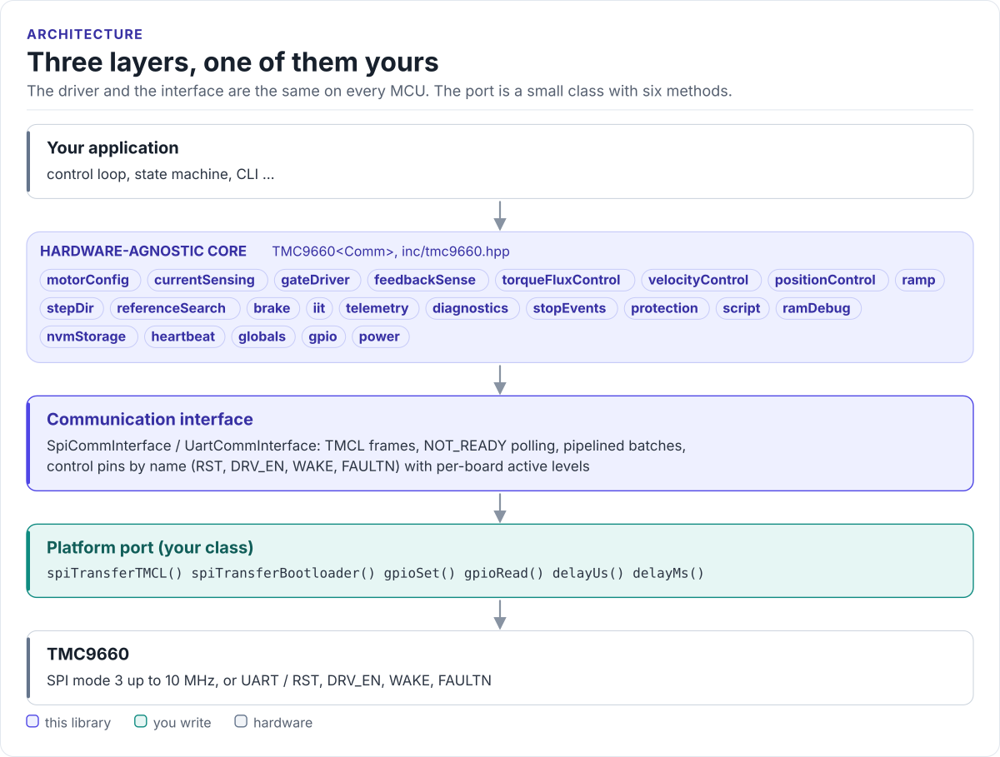

# Porting

Run the driver on a new MCU by writing one class: the communication interface for SPI or UART.

The driver never calls your SDK directly. It calls six methods on a class you derive from
`tmc9660::SpiCommInterface<Self>` or `tmc9660::UartCommInterface<Self>` (in
[`inc/tmc9660_comm_interface.hpp`](../inc/tmc9660_comm_interface.hpp)). The base classes use CRTP: the calls are
resolved at compile time, so there are no virtual functions, no vtable and nothing to allocate.

<!-- figure: driver-layers -->
<picture>
  <source media="(prefers-color-scheme: dark)" srcset="diagrams/driver-layers.dark.svg">
  
</picture>
<!-- /figure -->

## What you implement

| Method | SPI | UART | Contract |
| --- | :---: | :---: | --- |
| `spiTransferTMCL(tx[8], rx[8])` | yes | | One full-duplex 64-bit transfer, CS low for all 8 bytes. Return `false` on a bus error |
| `spiTransferBootloader(tx[5], rx[5])` | yes | | The same for 40-bit bootloader datagrams |
| `uartSendTMCL(data[9])` | | yes | Send one 9-byte TMCL frame |
| `uartReceiveTMCL(data[9])` | | yes | Return `true` only when all 9 reply bytes are in `data` |
| `uartTransferBootloader(tx[8], rx[8])` | | yes | Send 8 bytes, receive the 8-byte reply |
| `gpioSet(pin, signal)` | yes | yes | Drive RST, DRV_EN or WAKE to `ACTIVE` / `INACTIVE` |
| `gpioRead(pin, signal)` | yes | yes | Read FAULTN (and any other pin) as `ACTIVE` / `INACTIVE` |
| `delayMs(ms)`, `delayUs(us)` | yes | yes | Block for at least that long |
| `debugLog(level, tag, fmt, va_list)` | optional | optional | Print one line; 0 = error ... 4 = verbose |

## SPI port

```cpp title="my_spi.hpp"
--8<-- "tests/docs/my_spi.hpp:port"
```

Rules the transfer must follow:

- **SPI mode 3**, MSB first, up to 10 MHz.
- **One transaction per call.** CS goes low before the first byte and high after the last; never split a
  datagram, never merge two.
- **No delays of your own.** The driver polls the chip's NOT_READY status and backs off itself. A fixed delay
  in `spiTransferTMCL()` only makes every access slower. [Timing and throughput](timing.md) shows the numbers.
- **Return `false` only for a bus failure.** Protocol errors (bad checksum, NOT_READY) are the driver's job.

## UART port

```cpp title="my_uart.hpp"
--8<-- "tests/docs/my_uart.hpp:port"
```

`uartReceiveTMCL()` must block until it has exactly nine bytes, or fail. Returning early hands the driver a
partial frame: wrong status codes, checksum errors and faults that come and go. Flush stale bytes from the
receive FIFO before a bootloader exchange.

## Control-pin levels

The constructor takes the physical level of RST, DRV_EN, WAKE and FAULTN when each is active. The helpers
`signalToGpioLevel()` and `gpioLevelToSignal()` apply them, so `gpioSet()` and `gpioRead()` stay one line each.

| Board | RST | DRV_EN | WAKE | FAULTN | Constructor |
| --- | --- | --- | --- | --- | --- |
| ESP32 examples, TMC9660 evaluation kits | high | high | low | low | `(true, true, false, false)` |
| A board with an inverting RST buffer | low | high | low | low | `(false, true, false, false)` |

Change a level at run time with `set_pin_active_level(pin, level)`.

## Reference implementation

The ESP32 examples use [`esp32_tmc9660_bus.hpp`](../examples/esp32/main/esp32_tmc9660_bus.hpp): an ESP-IDF
`spi_master` port and a UART port, with FreeRTOS delays and `ESP_LOG` output. Start from it for any ESP-IDF
target.

## Check your port

1. Build it: both ports on this page are compiled by the host CI from
   [`tests/docs/`](../tests/docs/my_spi.hpp), with the driver instantiated over them.
2. Run `bootloaderInit()` with `retrieve_bootloader_info = true`: it reads and logs the bootloader version over
   your port before any motor configuration.
3. Read `telemetry.getSupplyVoltage()`: a plausible VS proves TMCL parameter access end to end.
4. Watch `comm.tmclStats()`: `failures` and `staleReplies` should stay at zero on a healthy link.

## Threads

The driver is not thread-safe. Give each TMC9660 one owner task, or guard every call on a driver object (and
its port) with one mutex. Several chips on separate ports can run in parallel.
